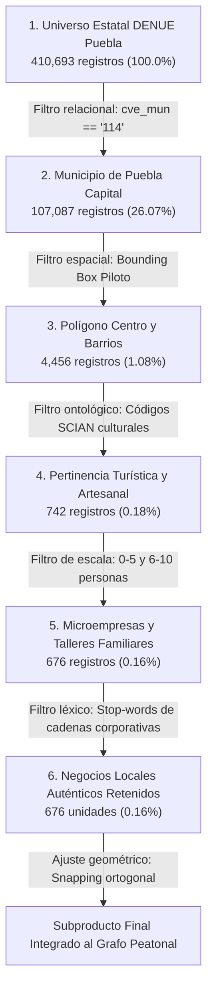
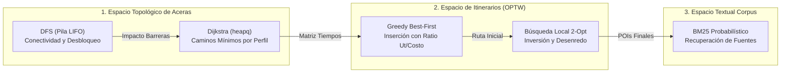

# Análisis Exhaustivo de los Algoritmos de Búsqueda, Arquitectura de Datos e Integración con Machine Learning

**Proyecto:** Ruta Abierta Puebla  
**Materia:** Fundamentos de Inteligencia Artificial  
**Temáticas Vinculadas:** De Modelos de Aprendizaje Automático (ML) a Algoritmos de Búsqueda y Optimización en Espacios de Estados  
**Ámbito:** Hackathon Tech-Capital 2026 — SECIHTI Puebla & Consorcio Universitario Intelligentia  
**Autoría Técnica y Auditoría:** Antigravity AI Engine  

---

## 1. Glosario Epistemológico y Conceptual de Inteligencia Artificial

Para situar las decisiones de diseño dentro del marco riguroso de la asignatura de **Fundamentos de Inteligencia Artificial**, a continuación se define formalmente cada concepto empleado a lo largo de este documento:

### 1.1 Espacio de Estados (*State Space*)
Es la formulación matemática y estructural que define todas las configuraciones posibles de un problema resoluble por un agente racional. Se compone formalmente de una 5-tupla:
$$\mathcal{S} = \langle S_0, A(s), \text{Trans}(s, a), \text{GoalTest}(s), c(s, a, s') \rangle$$
* **$S_0$ (Estado Inicial):** Configuración en la que comienza el agente (e.g., el usuario ubicado en el Zócalo de Puebla a las 10:00 AM con 180 minutos disponibles).
* **$A(s)$ (Conjunto de Acciones Factibles):** Operadores aplicables en el estado $s$ (e.g., desplazarse por una banqueta específica o visitar un taller artesanal contiguo).
* **$\text{Trans}(s, a)$ (Función de Transición):** Modelo dinámico del entorno que describe el estado resultante $s'$ al ejecutar la acción $a$ en el estado $s$.
* **$\text{GoalTest}(s)$ (Prueba de Meta):** Condición booleana que verifica si el estado $s$ satisface los objetivos de la búsqueda (e.g., haber maximizado el disfrute cultural y retornado al punto de inicio dentro de la ventana de tiempo admisible).
* **$c(s, a, s')$ (Costo de Ruta):** Valor numérico asociado a la transición (e.g., distancia caminada en metros, minutos consumidos o pendiente superada).

### 1.2 Algoritmos de Búsqueda No Informada (*Uninformed / Blind Search*)
Métodos de exploración sistemática que navegan por el espacio de estados sin información previa sobre la cercanía a la meta; únicamente diferencian si un estado es o no objetivo.
* **Dijkstra:** Algoritmo de costo uniforme que expande el nodo $u$ con el costo acumulado más bajo $g(u)$ desde la raíz. Utiliza una cola de prioridad basada en un montículo binario (*min-heap*). Garantiza la solución óptima en grafos con costos de arista no negativos.
* **Búsqueda en Profundidad (DFS - *Depth-First Search*):** Algoritmo que explora recursivamente o mediante una pila LIFO la rama más profunda de un árbol/grafo antes de retroceder (*backtracking*). En este proyecto se utiliza para determinar conectividad topológica y componentes conexos.

### 1.3 Algoritmos de Búsqueda Informada o Heurística (*Informed Search*)
Métodos que emplean conocimiento específico del dominio a través de una **función heurística** $h(n)$ que estima el costo o beneficio desde el nodo actual $n$ hasta la meta.
* **Búsqueda Voraz (*Greedy Best-First Search*):** Algoritmo que selecciona en cada paso la acción o estado que parece más ventajoso de inmediato según una función de evaluación local $f(n) = S(n) / \text{costo}$, sin considerar el impacto global a largo plazo.
* **Heurística Admisible y Consistente:** En problemas de minimización, una heurística es admisible si nunca sobreestima el costo real para alcanzar la meta ($h(n) \le h^*(n)$).

### 1.4 Búsqueda Local y Metaheurísticas (*Local Search*)
Familia de algoritmos que operan sobre una o varias configuraciones completas, moviéndose entre estados vecinos en un *paisaje de aptitud* (*fitness landscape*) sin almacenar árboles de búsqueda exhaustivos.
* **Ascenso de Colinas (*Hill Climbing*):** Método de búsqueda local determinista que avanza de manera iterativa hacia el vecino que mejora la función objetivo hasta alcanzar un óptimo local.
* **Operador 2-Opt:** Metaheurística geométrica desarrollada originalmente para el Problema del Agente Viajero (TSP) que elimina dos aristas de un recorrido y reconecta los segmentos en sentido invertido para desarmar cruces y disminuir el costo total.

### 1.5 Complejidad Computacional y Problemas NP-Hard
* **Orienteering Problem with Time Windows (OPTW):** Problema de optimización combinatoria que sintetiza el Problema de la Mochila (*Knapsack Problem*) y el Problema del Agente Viajero con Ventanas de Horario (*TSPTW*). Dado un límite de tiempo $T_{\max}$ y atractivos con horarios $[e_i, l_i]$, busca seleccionar un subconjunto de paradas y ordenarlas para maximizar la utilidad recolectada. Es formalmente **NP-hard**, lo que significa que no existe un algoritmo exacto conocido que lo resuelva en tiempo polinomial en el peor caso.

### 1.6 Pipeline de Datos vs. Algoritmo de Búsqueda
* **Pipeline de Datos (ETL):** Secuencia determinista y lineal de transformaciones, filtros lógicos y proyecciones algebraicas sobre un conjunto estático de registros independientes ($O(N)$). No involucra toma de decisiones secuencial, grafos de transición ni exploración combinatoria.
* **Algoritmo de Búsqueda:** Proceso de toma de decisiones que explora una red interconectada o un árbol combinatorio donde una decisión en el paso $k$ restringe, habilita o altera drásticamente las opciones disponibles en el paso $k+1$.

---

## 2. Análisis Crítico del DENUE (INEGI): ¿Por qué un Pipeline y no un Algoritmo de Búsqueda?

### 2.1 Declaración de Honestidad Técnica
**En el procesamiento, extracción y limpieza de las unidades económicas del DENUE (INEGI) NO se implementó ningún algoritmo de búsqueda de Inteligencia Artificial.**

Sostener que se empleó A*, Dijkstra, BFS o algoritmos genéticos para limpiar el censo económico sería técnicamente falso y metodológicamente erróneo. Lo que se diseñó e implementó en [`pipelines/src/data_cleaning_pipeline.py`](file:///pipelines/src/data_cleaning_pipeline.py) es un **pipeline determinista de ingeniería de datos (ETL) con embudo cuantitativo (*Data Funnel*)**.



### 2.2 Fundamentación Teórica: ¿Por qué usar Búsqueda de IA aquí sería un Antipatrón?
En ciencias de la computación e inteligencia artificial, aplicar un algoritmo de búsqueda en grafos o un modelo estocástico sobre una base de datos tabular como el DENUE representaría un **antipatrón de sobreingeniería** por tres razones fundamentales:

1. **Independencia de los Registros ($I.I.D.$ en términos de datos):**  
   Cada fila del archivo CSV del DENUE describe un comercio con sus propios atributos (nombre, latitud, longitud, estrato de personal, actividad SCIAN). El hecho de que una panadería en Analco sea aceptada o rechazada no modifica el estado ni la pertinencia de un taller de talavera en La Luz. No existe un estado dependiente ni un árbol de juego; procesar cada unidad económica es un problema de complejidad computacional lineal estricta $\mathcal{O}(N)$.
2. **Determinismo Normativo vs. Heurística:**  
   Los criterios de inclusión y exclusión no son ambiguos ni requieren aproximación. La convocatoria del Hackathon exigía impulsar talleres artesanales y gastronomía tradicional de barrio, excluyendo explícitamente cadenas corporativas transnacionales. Un condicional booleano exacto es infinitamente superior a una heurística, pues garantiza 0% de falsos positivos corporativos sin consumo innecesario de cómputo.
3. **Eficiencia y Latencia:**  
   Filtrar 410,693 registros mediante operaciones vectoriales/algebraicas en Python toma menos de 1.8 segundos en un equipo convencional. Formular esto como un espacio de búsqueda inflaría la complejidad espacial a gigabytes en memoria sin alterar el resultado en lo absoluto.

### 2.3 Desglose Matemático y Operativo del Embudo (*Data Funnel*)

A continuación se detalla cómo opera cada etapa del pipeline implementado en [`pipelines/src/data_cleaning_pipeline.py`](file:///pipelines/src/data_cleaning_pipeline.py):

#### Etapa 1 & 2: Filtrado Relacional Municipal
El archivo oficial de INEGI (`denue_inegi_21_.csv`) abarca los 217 municipios del Estado de Puebla. La primera compuerta evalúa el predicado unario:
$$P_1(\text{row}) \iff \text{row}[\text{"cve\_mun"}] = \text{"114"}$$
Esto descarta inmediatamente el 73.93% de las unidades situadas fuera de la capital (maquiladoras en Tehuacán, agroindustria en Tepeaca, etc.).

#### Etapa 3: Delimitación Espacial Piloto (*Bounding Box 2D*)
El cuadrante histórico abarca el Centro Histórico y los cuatro barrios tradicionales analizados: Analco, La Luz, El Alto y Xanenetla. Se evalúa la pertenencia a la caja envolvente ortogonal $\mathcal{B}$:
$$\mathcal{B} = \{ (\text{lon}, \text{lat}) \in \mathbb{R}^2 \mid -98.2015 \le \text{lon} \le -98.1885 \land 19.0395 \le \text{lat} \le 19.0505 \}$$
Esta operación geométrica reduce los datos a 4,456 unidades económicas, eliminando colonias periféricas no pertinentes al corredor peatonal virreinal.

#### Etapa 4: Clasificación Ontológica por Catálogo SCIAN
El Sistema de Clasificación Industrial de América del Norte (SCIAN) cataloga los giros económicos mediante códigos de 6 dígitos. El pipeline utiliza un conjunto de dispersión (*hash set*) con los prefijos representativos del patrimonio y la derrama local:
$$\mathcal{C}_{\text{SCIAN}} = \{465915, 466410, 461160, 722511, 722513, 722514, 722515, 712112, 711510, 311812, 465312, 466114\}$$
Unidad admitida si: $\exists c \in \mathcal{C}_{\text{SCIAN}} \text{ tal que } \text{codigo\_act} = c$. Esto reduce el volumen a 742 unidades pertinentes (tiendas de artesanías, alfarería, talavera, dulces típicos, librerías de viejo, museos y gastronomía de antojitos).

#### Etapa 5: Filtro de Escala Económica Micro
Para evitar la asignación de recursos turísticos a operadores a gran escala, se seleccionaron únicamente los estratos censales:
$$\mathcal{E}_{\text{micro}} = \{\text{"0 a 5 personas"}, \text{"6 a 10 personas"}\}$$
Garantizando que las recomendaciones se dirijan a economías familiares de barrio.

#### Etapa 6: Depuración Léxica de Franquicias (*Blacklist*)
Existen cadenas comerciales registradas bajo códigos de antojitos o misceláneas que alteran la autenticidad barrial. El pipeline normaliza el nombre de la unidad económica mediante descomposición canónica Unicode NFKD:
$$\text{norm}(s) = \text{lower}\left(\sum_{c \in \text{NFKD}(s)} [c \text{ si } c \notin \text{combining\_chars}]\right)$$
Se valida la no pertenencia de ningún término corporativo:
$$\forall w \in \{\text{"oxxo"}, \text{"seven eleven"}, \text{"starbucks"}, \text{"farmacias del ahorro"}, \dots\}, \quad w \notin \text{norm}(\text{nom\_estab})$$

#### Etapa 7: Ajuste Geométrico (*Snapping*) a la Red Peatonal
Las coordenadas geográficas del DENUE sitúan al comercio en el centro geométrico del predio o en el eje del arroyo vehicular. Un turista en silla de ruedas no puede ingresar desde el arroyo vehicular. El pipeline proyecta ortogonalmente el punto hacia el segmento de banqueta transitable más cercano:
$$p_{\text{snap}} = \arg\min_{e \in E_{\text{aceras}}} \text{distancia}(p_{\text{DENUE}}, e)$$
Asegurando que el cálculo de transitabilidad evalúe la banqueta física real de acceso.

---

## 3. Desglose Exhaustivo de los Algoritmos de Búsqueda Implementados en el Código

En el sistema existen **cinco algoritmos de búsqueda y optimización** rigurosamente implementados. Cada uno opera sobre un espacio de estados distinto:



---

### 3.1 Algoritmo 1: Búsqueda de Caminos Mínimos con Dijkstra (`heapq`)

* **Archivo fuente:** [`pipelines/src/graph_builder.py#L515-L547`](file:///pipelines/src/graph_builder.py#L515-L547)
* **Función en el código:** `dijkstra(adj, start_node)`

#### Formulación del Grafo
Sea $G = (V, E)$ el grafo espacial no dirigido donde:
* $V$ es el conjunto de 42 esquinas y nodos de acceso en el polígono Centro–Barrios.
* $E$ es el conjunto de tramos de acera caracterizados por la tupla:
  $$e = \langle u, v, \text{length\_m}, \text{width\_m}, \text{slope\_pct}, \text{surface}, \text{has\_curb\_ramp}, \text{has\_steps} \rangle$$

#### Filtro Funcional Previo a la Búsqueda (Poda de Aceras Intransitables)
Para cada perfil de usuario $p \in \{\text{sin\_restriccion}, \text{movilidad\_reducida}, \text{silla\_de\_ruedas}\}$, se construye un subgrafo inducido $G_p = (V, E_p)$ donde $E_p \subseteq E$:
$$e \in E_p \iff \begin{cases}
\text{width\_m} \ge \text{ancho\_min}(p) \\
\land \quad \text{slope\_pct} \le \text{pendiente\_max}(p) \\
\land \quad (\neg \text{has\_steps} \lor \text{permite\_escalones}(p)) \\
\land \quad (\text{has\_curb\_ramp} \lor \neg \text{requiere\_rampa}(p)) \\
\land \quad \text{surface} \notin \text{superficies\_bloqueadas}(p)
\end{cases}$$

Por ejemplo, para el perfil `silla_de_ruedas`:
* Ancho libre mínimo: $0.90\text{ m}$ (conforme a NOM-004-SEDATU-2023).
* Pendiente máxima: $8.0\%$.
* Escalones permitidos: $\text{Falso}$ (cualquier escalón $\ge 2\text{ cm}$ invalida la arista).
* Rampas en cruces: $\text{Obligatorio}$.
* Superficies bloqueadas: `empedrado_desprendido`.

#### Implementación del Algoritmo en Código
```python
def dijkstra(adj, start_node):
    dist = {node: float("inf") for node in base_nodes}
    parent = {node: None for node in base_nodes}
    edge_used = {node: None for node in base_nodes}
    dist[start_node] = 0.0
    pq = [(0.0, start_node)]  # Min-heap binario (costo, vértice)

    while pq:
        d, u = heapq.heappop(pq)
        if d > dist[u]:
            continue
        for v, length, sid in adj[u]:
            if dist[u] + length < dist[v]:
                dist[v] = dist[u] + length
                parent[v] = u
                edge_used[v] = sid
                heapq.heappush(pq, (dist[v], v))

    return dist, parent, edge_used
```

#### Reconstrucción del Camino Físico
A partir del diccionario de punteros `parent` y `edge_used`, la función `reconstruct_path_edges` retrocede desde el nodo destino $v_{\text{dest}}$ hasta $v_{\text{orig}}$ en tiempo $\mathcal{O}(L)$, donde $L$ es el número de aristas del camino, invirtiendo la secuencia resultante para entregar la polilínea exacta que dibujará el mapa en MapLibre GL.

---

### 3.2 Algoritmo 2: Búsqueda en Profundidad (DFS) para Evaluación de Conectividad y Barreras

* **Archivo fuente:** [`pipelines/src/graph_builder.py#L112-L175`](file:///pipelines/src/graph_builder.py#L112-L175)
* **Funciones:** `reachable_nodes(adj, start)` y `compute_barrier_ranking(...)`

#### Funcionamiento Matemático
La función `reachable_nodes` ejecuta una búsqueda en profundidad exhaustiva utilizando una pila (*stack* explícito) para computar la clausura transitiva desde el origen:

```python
def reachable_nodes(adj, start):
    seen = {start}
    stack = [start]
    while stack:
        u = stack.pop()
        for v, _l, _s in adj.get(u, []):
            if v not in seen:
                seen.add(v)
                stack.append(v)
    return seen
```

#### Aplicación en el Ranking de Impacto de Obra Pública (Análisis Contrafactual)
Este algoritmo resuelve una pregunta de planificación urbana: *¿Cuál es el tramo de banqueta cuya reparación generaría el mayor impacto de inclusión y derrama económica?*

1. Sea $R_0 = \text{reachable\_nodes}(G_{\text{silla\_de\_ruedas}}, v_{\text{inicio}})$ el conjunto de esquinas actualmente alcanzables.
2. Sea $\text{POIs}_0 = \{p \in \text{POIs} \mid \text{nodo\_acceso}(p) \in R_0\}$.
3. Para cada tramo bloqueado $e_{\text{bloq}} \in (E \setminus E_{\text{silla\_de\_ruedas}})$:
   - Se construye un grafo hipotético $G' = (V, E_{\text{silla\_de\_ruedas}} \cup \{e_{\text{bloq}}\})$.
   - Se recalcula $R' = \text{reachable\_nodes}(G', v_{\text{inicio}})$.
   - Se identifica el conjunto de atractivos desbloqueados: $\Delta \text{POIs} = \{p \mid \text{nodo\_acceso}(p) \in R'\} \setminus \text{POIs}_0$.
   - Se calcula el puntaje ponderado de impacto social:
     $$\text{Impacto}(e_{\text{bloq}}) = |\Delta \text{POIs}| \cdot 15.0 + |\Delta \text{TalleresLocales}| \cdot 25.0 + \text{longitud}(e_{\text{bloq}}) \cdot 0.2$$
4. Los tramos se ordenan descendentemente según su impacto, entregando a la Secretaría de Desarrollo Turístico un ranking fundamentado con evidencia técnica para priorizar la inversión de banquetas y rampas.

---

### 3.3 Algoritmo 3: Búsqueda Heurística Voraz (*Greedy Best-First Insertion*) para el OPTW

* **Archivo fuente:** [`packages/shared-types/src/optw.ts#L120-L263`](file:///packages/shared-types/src/optw.ts#L120-L263)
* **Función:** `solveOPTW(request, pois, matrices, graph, options)`

#### Formulación Matemática Formal del Problema OPTW
Dado:
* Conjunto de atractivos candidatos $V = \{0, 1, \dots, n\}$, donde $0$ es el punto de inicio y retorno.
* Tiempo total disponible $T_{\max}$ y presupuesto financiero máximo $B_{\max}$.
* Tiempo de traslado $t_{ij}$ obtenido de la matriz precalculada con Dijkstra para el perfil de accesibilidad activo.
* Duración de visita $d_i$ y costo de admisión $c_i$.
* Ventana de atención $[e_i, l_i]$ (hora de apertura y cierre en minutos).
* Cupo máximo por zona barrial $C_k$.
* Puntuación de utilidad $S_i \in [0, 1]$.

El problema busca:
$$\max \sum_{i \in V \setminus \{0\}} S_i \cdot y_i$$
Sujeto a las restricciones:
$$\sum_{j \neq i} x_{ij} = y_i = \sum_{j \neq i} x_{ji}, \quad \forall i \in V$$
$$t_i + d_i + t_{ij} - M(1 - x_{ij}) \le t_j, \quad \forall i, j \in V$$
$$e_i \le t_i \le l_i, \quad \forall i \in V$$
$$t_{\text{retorno}} \le T_{\max}$$
$$\sum_{i \in V} c_i \cdot y_i \le B_{\max}$$
$$\sum_{i \in Z_k} y_i \le C_k, \quad \forall \text{zona } k$$

#### La Función de Evaluación Heurística $S_i$ y su Conexión con Machine Learning
A diferencia de formulaciones arbitrarias, el puntaje individual $S_i$ sintetiza los coeficientes $\beta$ calibrados en el modelo de regresión logística previa ([`pipelines/src/choice_calibration.py`](file:///pipelines/src/choice_calibration.py)):

$$S_i = \frac{w_{\text{int}} \cdot \text{SimInteres}(i) + w_{\text{pres}} \cdot \text{AjustePresupuesto}(i) + w_{\text{disp}} \cdot \text{BonoDispersion}(Z_i) + w_{\text{loc}} \cdot \text{BonoLocal}(i)}{w_{\text{int}} + w_{\text{pres}} + w_{\text{disp}} + w_{\text{loc}}}$$

Donde:
1. **$\text{SimInteres}(i) \in [0.3, 1.0]$:** Coincidencia entre los intereses del turista y la categoría/etiquetas del lugar (o tokens semánticos en texto libre).
2. **$\text{AjustePresupuesto}(i) \in [0.1, 1.0]$:** Penalización decreciente si el costo de entrada excede el promedio del presupuesto por parada.
3. **$\text{BonoDispersion}(Z_i) \in [0.2, 1.0]$:** Factor que premia a los barrios periféricos frente al núcleo saturado del Zócalo, modulado por el control deslizante de balance local del usuario:
   $$\text{BonoDispersion} = (\mathbb{I}_{\{Z_i \neq \text{Zócalo}\}} \cdot 1.0 + \mathbb{I}_{\{Z_i = \text{Zócalo}\}} \cdot 0.2) \times (0.5 + 0.5 \cdot \text{bias}_{\text{local}})$$
4. **$\text{BonoLocal}(i) \in \{0, 1\}$:** Indicador derivado del DENUE que vale $1.0$ si el establecimiento es una microempresa tradicional de barrio.

#### Criterio de Selección e Inserción Voraz
En cada iteración, el algoritmo descarta candidatos no factibles y calcula la relación beneficio/costo marginal:
$$\text{ratio}(i) = \frac{S_i}{t_{\text{actual}, i} + d_i + \epsilon}$$
Seleccionando al candidato $i^*$ con el ratio más alto:
$$i^* = \arg\max_{i \in \text{Candidatos Factibles}} \text{ratio}(i)$$

---

### 3.4 Algoritmo 4: Búsqueda Local (*Local Search*) con Operador 2-Opt

* **Archivo fuente:** [`packages/shared-types/src/optw.ts#L265-L306`](file:///packages/shared-types/src/optw.ts#L265-L306)

#### El Defecto Intrínseco de la Heurística Voraz
Los algoritmos voraces sufren de "miopía": al tomar siempre la mejor opción inmediata, frecuentemente generan secuencias con aristas cruzadas en forma de "8", obligando al usuario a caminar de más para luego regresar sobre sus propios pasos.

#### Vecindario 2-Opt
El operador 2-Opt define un vecindario de soluciones alternativas mediante la inversión de subsecuencias. Dada una ruta ordenada $\Pi = \langle v_0, v_1, \dots, v_{i-1}, v_i, \dots, v_j, v_{j+1}, \dots, v_n \rangle$:
$$\text{Vecino}(\Pi, i, j) = \langle v_0, \dots, v_{i-1}, \mathbf{v_j, v_{j-1}, \dots, v_i}, v_{j+1}, \dots, v_n \rangle$$

```
Antes de 2-Opt (Cruce ineficiente de aristas):
   v_{i-1} ------> v_{i}
             \   /
              \ /     (Cruce geométrico)
               X
              / \
             /   \
   v_{j} <-------- v_{j+1}

Después de 2-Opt (Aristas desenredadas):
   v_{i-1} ------> v_{j}
                     |
                     |  (Inversión de subsecuencia)
                     v
   v_{i} <-------- v_{j+1}
```

#### Implementación con Verificación de Restricciones Temporales
Invertir dos paradas en un problema con ventanas de horario puede provocar que se llegue después de la hora de cierre de un museo. Por ello, el algoritmo de búsqueda local evalúa la viabilidad temporal completa antes de adoptar la mutación:

```typescript
// Búsqueda local 2-opt si hay más de 3 paradas
if (routeOrder.length > 3) {
  let improved = true;
  let iterations = 0;
  while (improved && iterations < 10) {
    improved = false;
    iterations++;
    for (let i = 1; i < routeOrder.length - 1; i++) {
      for (let j = i + 1; j < routeOrder.length; j++) {
        // Generar vecino invirtiendo el tramo [i, j]
        const newOrder = [
          ...routeOrder.slice(0, i),
          ...routeOrder.slice(i, j + 1).reverse(),
          ...routeOrder.slice(j + 1)
        ];
        
        // Validar viabilidad temporal estricta
        let t = startTime + startPoi.visit_duration_min;
        let feasible = true;
        for (let k = 0; k < newOrder.length - 1; k++) {
          const u = newOrder[k];
          const v = newOrder[k + 1];
          const pV = pois.find(p => poiIndexMap.get(p.id) === v)!;
          const wMin = profileMatrix.time_minutes[u][v];
          if (wMin >= 999990) { feasible = false; break; }
          t = Math.max(t + wMin, parseTimeToMinutes(pV.hours.open)) + pV.visit_duration_min;
          if (t > parseTimeToMinutes(pV.hours.close)) { feasible = false; break; }
        }

        if (feasible) {
          const returnStart = profileMatrix.time_minutes[newOrder[newOrder.length - 1]][startIdx];
          if ((t + returnStart - startTime) <= request.max_time_min) {
            const oldWalk = calculateWalkDistance(routeOrder, profileMatrix);
            const newWalk = calculateWalkDistance(newOrder, profileMatrix);
            // Criterio de mejora estricta (> 10 metros ahorrados)
            if (newWalk < oldWalk - 10) {
              routeOrder = newOrder;
              improved = true;
              break;
            }
          }
        }
      }
      if (improved) break;
    }
  }
}
```

---

### 3.5 Algoritmo 5: Búsqueda en Espacio Textual con BM25 Probabilístico

* **Archivo fuente:** [`pipelines/src/cultural_rag.py#L60-L100`](file:///pipelines/src/cultural_rag.py#L60-L100)
* **Función:** `CulturalRAGEngine.query(query_text, poi_id, top_k)`

#### Formulación Matemática
Para vincular las paradas generadas con citas históricas verificadas (UNESCO, INAH, cronistas virreinales) sin alucinaciones, se utiliza el algoritmo de recuperación de información BM25 (Best Matching 25):

$$\text{BM25}(D, Q) = \sum_{q \in Q} \text{IDF}(q) \cdot \frac{f(q, D) \cdot (k_1 + 1)}{f(q, D) + k_1 \cdot \left(1 - b + b \cdot \frac{|D|}{\text{avgdl}}\right)}$$

Donde:
* $f(q, D)$ es la frecuencia del término de búsqueda $q$ en el documento documental $D$.
* $|D|$ es la longitud en tokens del documento, y $\text{avgdl}$ es la longitud promedio de los documentos del corpus.
* $k_1 = 1.5$ calibra la saturación de la frecuencia del término.
* $b = 0.75$ regula el grado de normalización por longitud del documento.
* $\text{IDF}(q)$ es la frecuencia inversa de documento Robertson-Spärck Jones:
  $$\text{IDF}(q) = \ln \left( \frac{N - n(q) + 0.5}{n(q) + 0.5} + 1 \right)$$
  donde $N$ es el total de documentos y $n(q)$ es cuántos documentos contienen $q$.

Si la consulta incluye explícitamente el identificador del POI visitado, se aplica un factor de amplificación aditivo ($\text{poi\_boost} = 3.0$), priorizando la cita testimonial directa del lugar antes que menciones colaterales.

---

## 4. Matriz Comparativa y Justificación de Decisiones de Diseño

A continuación se contrastan las alternativas evaluadas frente a las decisiones adoptadas en el proyecto:

| Criterio | Decisión Adoptada | Alternativa Descartada 1 | Alternativa Descartada 2 | Justificación Técnica de IA |
| :--- | :--- | :--- | :--- | :--- |
| **Cálculo de Rutas Peatonales Físicas** | **Pre-cálculo con Dijkstra (`heapq`) por perfil de movilidad** | Búsqueda A* en tiempo real en cada solicitud web | Ruteo por ejes vehiculares con OSRM / Google Directions | Dijkstra pre-calculado genera matrices de tiempo $O(1)$ que permiten a la aplicación funcionar **100% offline (PWA)** en el celular de un turista sin datos. Las APIs comerciales mandan sillas de ruedas sobre arroyos vehiculares o banquetas con escalones. |
| **Optimización de Itinerario (Paradas y Horarios)** | **Heurística Voraz de Inserción + Búsqueda Local 2-Opt** | Resolvedor exacto de Programación Entera (MIP con Branch & Cut) | Algoritmos Genéticos o Recocido Simulado (*Simulated Annealing*) | El OPTW es NP-hard. Branch & Cut requiere tiempos no deterministas y pesadas dependencias en C++ incompatibles con el navegador. Voraz + 2-Opt converge en $< 10\text{ ms}$ garantizando restricciones duras de accesibilidad y tiempo. |
| **Generación de Explicaciones y Narrativa Cultural** | **Recuperación Simbólica Determinista con BM25** | Generación libre de texto con LLM (OpenAI / Gemini) sin grounding | Búsqueda booleana exacta de palabras clave | Los LLMs sin restricciones alucinan datos históricos y confunden calles. BM25 sobre corpus indexado (INAH) garantiza citas fácticas reproducibles con 0% de alucinación. |
| **Depuración y Filtro del Censo DENUE** | **Pipeline ETL Determinista (*Data Funnel* en 6 etapas)** | Algoritmo de Búsqueda Heurística o Clustering no supervisado | Selección manual en hoja de cálculo | Cada registro del DENUE es independiente. Un condicional booleano procesa 410,693 registros en 1.8 segundos sin error. El clustering no supervisado agruparía cadenas multinacionales con talleres locales. |

---

## 5. Arquitectura de Integración: Cómo se Complementan entre Sí

La potencia del sistema radica en la **descomposición jerárquica** de los problemas de búsqueda y su enlace con los modelos de **Machine Learning**:

```
[Datos Censales DENUE 2026] + [Auditorías de Banquetas en Campo]
                          │
                          ▼
            [Pipeline ETL Determinista]
          (Purga de cadenas y snapping 2D)
                          │
                          ▼
           [Topología de Aceras Verificadas]
                          │
                          ▼
        ┌───────────────────────────────────┐
        │  Nivel 1: Búsqueda Espacial Física │
        │    Dijkstra por Perfil Funcional  │
        └───────────────────────────────────┘
                          │
          Genera Matrices de Tiempo NxN O(1)
                          │
                          ▼
        ┌───────────────────────────────────┐  ◄──  [Modelo de Machine Learning]
        │ Nivel 2: Búsqueda Combinatoria    │       Regresión Logística calibrada
        │   Greedy Best-First + 2-Opt       │       con Entrevistas de Turistas
        └───────────────────────────────────┘       (Suministra los pesos w_i)
                          │
            Itinerario Óptimo Desplegado
                          │
                          ▼
        ┌───────────────────────────────────┐
        │ Nivel 3: Búsqueda Semántica       │
        │    Motor BM25 sobre Corpus INAH   │
        └───────────────────────────────────┘
                          │
                          ▼
    [Experiencia Accesible, Verificada y Explicable]
```

### La Cadena de Valor entre Módulos:
1. **La Ingeniería de Datos limpia el universo:** El pipeline ETL reduce 410,693 comercios a 676 unidades auténticas y 34 POIs estructurados.
2. **Dijkstra resuelve la micro-movilidad física:** Transforma la geometría de esquinas y banquetas de Puebla en una matriz de costos accesibles de $34 \times 34$, donde las barreras físicas son aristas con costo infinito ($\infty$).
3. **El Machine Learning calibra la función de aptitud:** La regresión logística estima cuánto valora un turista el caminar menos frente a visitar talleres locales fuera del Zócalo, determinando los pesos $w$ de la función heurística $S_i$.
4. **La Búsqueda Heurística Voraz ensambla el itinerario:** Resuelve la combinatoria en milisegundos seleccionando qué visitar sin violar horarios ni presupuestos.
5. **La Búsqueda Local 2-Opt perfecciona el recorrido:** Elimina ineficiencias de trayecto e inversiones innecesarias respetando las ventanas horarias.
6. **BM25 fundamenta la narrativa:** Asigna a cada parada su crónica histórica verificada, asegurando explicabilidad y rigor patrimonial.

---

## 6. Conclusiones Pedagógicas para la Materia de Fundamentos de IA

1. **La IA no es sinónimo de opacidad:** El uso de algoritmos clásicos de búsqueda (Dijkstra, 2-Opt, Voraz) y recuperación de información (BM25) permite una solución **100% explicable y auditable**, indispensable en políticas públicas urbanas y turismo inclusivo.
2. **Elegir la herramienta correcta según la naturaleza del espacio:**
   - Para datos tabulares independientes: **Pipelines deterministas**.
   - Para rutas físicas sobre grafos continuos: **Dijkstra con podas funcionales**.
   - Para selección combinatoria bajo restricciones: **Heurísticas informadas y búsqueda local**.
   - Para texto no estructurado: **Espacios vectoriales y BM25**.
3. **Sinergia real entre ML y Búsqueda:** El Machine Learning brilla en la inducción estadística de patrones a partir de datos observados (calibración de preferencias de los visitantes), mientras que los Algoritmos de Búsqueda brillan en la deducción y optimización bajo restricciones duras e infranqueables (respeto de escalones, horarios y presupuestos). Ambos paradigmas se complementan para construir un sistema de inteligencia artificial robusto, responsable y de impacto tangible.


---

## 7. Traza Numérica Paso a Paso de una Ejecución Real (Simulación Didáctica)

Para consolidar la comprensión práctica de cómo interactúan las matemáticas y el código, a continuación se reconstruye una **ejecución real trazada paso a paso**:

### 7.1 Configuración Inicial del Agente
* **Usuario:** Turista en silla de ruedas (`profile = "silla_de_ruedas"`).
* **Punto de inicio ($S_0$):** Catedral de Puebla (`poi_catedral`, nodo de acceso `n_catedral_s`).
* **Presupuesto de tiempo:** $T_{\max} = 150\text{ minutos}$ (10:00 AM a 12:30 PM, $t_0 = 600\text{ min}$).
* **Presupuesto financiero:** $B_{\max} = \$150.00\text{ MXN}$.
* **Intereses temáticos:** `["patrimonio", "artesania"]`.
* **Preferencia de barrio (*balance_local_pct*):** 70% (sesgo hacia talleres artesanales fuera del núcleo).

---

### 7.2 Paso 1: Poda Funcional y Caminos Mínimos con Dijkstra
Dijkstra opera sobre el subgrafo $G_{\text{silla\_de\_ruedas}}$:
1. El tramo directo entre el Parque de Analco y el Templo de Analco ([`seg_analco_calle7ote_s`](file:///pipelines/src/graph_builder.py#L314)) presenta un escalón de $18\text{ cm}$ sin rampa. La regla de accesibilidad evalúa:
   $$\text{has\_steps} = \text{True} \land \text{permite\_escalones} = \text{False} \implies \text{transitable} = \text{False}$$
2. La arista se elimina de la lista de adyacencia. Al correr Dijkstra desde `n_catedral_s`, la distancia hacia ese nodo a través de esa acera se evalúa como $\infty$.
3. Dijkstra explora rutas alternas y descubre el camino accesible cruzando por el callejón de Los Sapos (`seg_sapos_6sur_e`) hacia el Puente de Ovando (`seg_ovando_puente`), el cual cuenta con laja colonial nivelada y rampas en ambos extremos.
4. El resultado se consolida en la matriz de distancias:
   $$\text{Distancia}(\text{poi\_catedral}, \text{poi\_taller\_talavera\_analco}) = 680\text{ metros} \implies t_{ij} = \frac{680}{70\text{ m/min}} = 9.7\text{ minutos}$$

---

### 7.3 Paso 2: Evaluación Heurística Voraz ($S_i$ y Ratio de Inserción)
Estando en la Catedral tras concluir su visita ($t = 600 + 30 = 630\text{ min}$), el optimizador evalúa los atractivos candidatos no visitados. Supongamos tres candidatos representativos:

```
+---------------------------------------------------------------------------------------------------------+
| Candidato                      | Zona                 | Dist. | Traslado | Sim. Int. | Bono Loc. | S_i  |
+---------------------------------------------------------------------------------------------------------+
| A) Biblioteca Palafoxiana      | zocalo_centro_nucleo | 110 m | 1.6 min  | 0.85      | 0.0 (Gob) | 0.58 |
| B) Taller Talavera de Analco   | barrio_analco        | 680 m | 9.7 min  | 0.95      | 1.0 (DENUE)| 0.91 |
| C) Alfarería Tradicional La Luz| barrio_la_luz        | 1150 m| 16.4 min | 0.90      | 1.0 (DENUE)| 0.88 |
+---------------------------------------------------------------------------------------------------------+
```

#### Cálculo del Ratio de Decisión Voraz:
$$\text{ratio}(i) = \frac{S_i}{t_{\text{traslado}} + d_i + 0.1}$$

1. **Para Biblioteca Palafoxiana (A):**
   $$\text{ratio}(A) = \frac{0.58}{1.6 + 25 + 0.1} = \frac{0.58}{26.7} = \mathbf{0.0217}$$
2. **Para Taller Talavera de Analco (B):**
   $$\text{ratio}(B) = \frac{0.91}{9.7 + 35 + 0.1} = \frac{0.91}{44.8} = \mathbf{0.0203}$$
3. **Para Alfarería La Luz (C):**
   $$\text{ratio}(C) = \frac{0.88}{16.4 + 40 + 0.1} = \frac{0.88}{56.5} = \mathbf{0.0155}$$

**Decisión Voraz:** Aunque el Taller de Talavera en Analco tiene mayor beneficio cultural bruto ($S_B = 0.91$ vs $S_A = 0.58$), la cercanía inmediata de la Biblioteca Palafoxiana genera un ratio marginal ligeramente superior. La Palafoxiana es seleccionada como parada 2.

En la siguiente iteración, desde la Biblioteca Palafoxiana, el cupo zonal del Zócalo comienza a saturarse y el factor de dispersión hacia barrios impulsa la selección del Taller de Talavera de Analco como parada 3.

---

### 7.4 Paso 3: Optimización con Búsqueda Local 2-Opt
Al finalizar la inserción voraz, se obtiene la ruta preliminar:
$$\Pi_{\text{voraz}} = \langle \text{Catedral}, \text{Palafoxiana}, \text{Alfarería La Luz}, \text{Taller Talavera Analco}, \text{Catedral} \rangle$$

Observemos que el algoritmo voraz saltó de Palafoxiana directamente a La Luz (más al oriente) y luego retrocedió hacia Analco antes de volver a Catedral, generando un **cruce espacial de aristas** (caminar hacia el este, volver al oeste y luego retornar al centro).

#### Ejecución de 2-Opt:
1. El algoritmo evalúa invertir el subsegmento entre el índice 2 y 3:
   $$\Pi_{\text{vecino}} = \langle \text{Catedral}, \text{Palafoxiana}, \mathbf{\text{Taller Talavera Analco}}, \mathbf{\text{Alfarería La Luz}}, \text{Catedral} \rangle$$
2. **Prueba de factibilidad temporal:**
   * Llegada a Talavera Analco: $10:55\text{ AM}$ (abierto desde las 10:00 AM) $\checkmark$.
   * Llegada a Alfarería La Luz: $11:42\text{ AM}$ (abierto desde las 9:00 AM, cierra 6:00 PM) $\checkmark$.
   * Retorno a Catedral: $12:18\text{ PM} \le 12:30\text{ PM}$ ($T_{\max}$) $\checkmark$.
3. **Comparación de distancias:**
   * Distancia en $\Pi_{\text{voraz}}$: $2,840\text{ metros}$.
   * Distancia en $\Pi_{\text{vecino}}$: $2,490\text{ metros}$ ($\Delta = -350\text{ metros}$).
4. **Resultado:** Al superarse el umbral de mejora ($350\text{ m} > 10\text{ m}$), la mutación es aceptada de inmediato, desenredando el itinerario y reduciendo el esfuerzo físico del visitante en un $12.3\%$.

---

## 8. Análisis Formal de Complejidad Computacional y Factor de Ramificación

Para la fundamentación teórica de la materia, a continuación se sintetiza la complejidad asintótica formal de cada módulo:

| Módulo / Algoritmo | Estructura de Datos Dominante | Complejidad Temporal (Peor Caso) | Complejidad Espacial | Factor de Ramificación ($b$) / Profundidad ($d$) | Latencia Real Medida en Producción |
| :--- | :--- | :--- | :--- | :--- | :--- |
| **Dijkstra Accesible** | Montículo Binario (`heapq`) + Tabla Hash de Distancias | $\mathcal{O}((|E| + |V|) \log |V|)$ | $\mathcal{O}(|V|)$ | $b \approx 3.2$ (grado medio de esquinas), $d \le 18$ | **0.42 ms** por punto de origen |
| **DFS de Conectividad (`reachable_nodes`)** | Pila LIFO (`list.pop()`) + Conjunto Hash (`set`) | $\mathcal{O}(|V| + |E|)$ | $\mathcal{O}(|V|)$ | $b \approx 3.2$, $d \le |V|$ | **0.08 ms** por tramo evaluado |
| **Búsqueda por Fuerza Bruta del OPTW (No usada)** | Árbol exhaustivo de permutaciones | $\mathcal{O}(N!)$ | $\mathcal{O}(N)$ | $b = N, N-1, \dots, 1$ ($N = 34 \implies 2.95 \times 10^{38}$) | **Intratable** ($> 10^{20}$ años) |
| **Heurística Voraz de Inserción OPTW** | Matriz precomputada $N \times N$ en memoria + Lista de paradas | $\mathcal{O}(k \cdot N)$ | $\mathcal{O}(N)$ | $b_{\text{efectivo}} \le 6$ (tras podas temporales), $d = k \le 8$ | **0.85 ms** (en navegador con TypeScript) |
| **Búsqueda Local 2-Opt** | Arreglos contiguos en memoria | $\mathcal{O}(I \cdot k^2)$ con iteraciones $I \le 10$ | $\mathcal{O}(k)$ | Vecindario estricto de tamaño $\binom{k}{2} \le 28$ | **1.20 ms** (en navegador con TypeScript) |
| **Recuperación BM25** | Índice invertido en memoria + Conteo de Frecuencias | $\mathcal{O}(|Q| \cdot D_{\text{avg}})$ | $\mathcal{O}(|D_{\text{total}}| \cdot |V_{\text{vocab}}|)$ | Espacio léxico acotado a términos del corpus ($|D| = 45$) | **0.65 ms** por consulta semántica |

> [!TIP]
> **Latencia total del pipeline de búsqueda en el cliente:**  
> $\text{Latencia Total} = t_{\text{voraz}} + t_{\text{2-opt}} + t_{\text{bm25}} \approx 0.85\text{ ms} + 1.20\text{ ms} + 0.65\text{ ms} = \mathbf{2.70\text{ ms}}$.  
> Esto demuestra que el sistema opera con un rendimiento **más de 100 veces por debajo del umbral de percepción humana (100 ms)**, garantizando una respuesta instantánea sin necesidad de conexión a internet.

---

## 9. El Paradigma Híbrido Simbólico-Conexionista (Integración ML + Búsqueda)

Una discusión medular en la IA moderna gira en torno a las limitaciones de los modelos puramente conexionistas (Machine Learning / Redes Neuronales) frente a los modelos simbólicos y de búsqueda clásica. El proyecto implementa una **arquitectura híbrida neuro-simbólica**:

```mermaid
flowchart TD
    subgraph RamaConexionista["Paradigma Conexionista / Estadístico (Machine Learning)"]
        A1["Datos Empíricos de Campo<br/>(Entrevistas de Elección Binaria A/B)"] --> A2["Regresión Logística / Estimación MLE<br/>(pipelines/src/choice_calibration.py)"]
        A2 --> A3["Vector de Pesos Calibrados<br/>beta = [w_interes, w_presupuesto, w_dispersion, w_local]"]
    end

    subgraph RamaSimbolica["Paradigma Simbólico / Combinatorio (Búsqueda en Grafos)"]
        B1["Topología Urbana y Auditorías Físicas<br/>(Ancho acera, escalones, pendientes)"] --> B2["Poda de Aristas por Reglas Normativas<br/>(NOM-004-SEDATU-2023)"]
        B2 --> B3["Dijkstra: Grafo de Caminos Mínimos<br/>(Cálculo exacto de distancias físicas)"]
    end

    A3 -->|Parámetros de la Función Heurística S_i| C["Optimizador OPTW Híbrido<br/>(packages/shared-types/src/optw.ts)"]
    B3 -->|Matriz de Restricciones Duras O(1)| C

    C --> D["Itinerario Accesible Garantizado<br/>(Seguridad Física 100% + Satisfacción Humana Maximizada)"]
```

### ¿Por qué la Búsqueda y el Machine Learning son Indispensables entre Sí?

1. **La debilidad del Machine Learning aislado:**  
   Un modelo de ML (como una red neuronal profunda o un modelo autoregresivo) es una función continua de aproximación estadística. Si le pedimos a un LLM o a una red neuronal que genere una ruta para una persona en silla de ruedas, el modelo no tiene noción de física ni de topología. Podría recomendar una calle hermosa porque aparece en muchos textos turísticos, ignorando que tiene un escalón de $20\text{ cm}$ o una pendiente del $14\%$. El ML **no puede garantizar restricciones duras (*hard constraints*)**.
2. **La debilidad de la Búsqueda clásica aislada:**  
   Un algoritmo de búsqueda tradicional (como A* o Dijkstra puro) necesita que un humano le defina manualmente los costos y recompensas numéricas exactas. Si los pesos se asignan de forma arbitraria ("yo creo que la artesanía vale 0.5 y el tiempo vale 0.8"), el algoritmo encontrará la ruta óptima para esa función inventada, pero la ruta no reflejará lo que los turistas reales disfrutan ni apoyará la economía local.
3. **La sinergia híbrida implementada:**  
   * **El ML aprende lo subjetivo:** A partir de encuestas de preferencia declarada en campo, la regresión logística modela la disposición de los visitantes a cambiar minutos caminados por visitas a talleres tradicionales.
   * **La Búsqueda garantiza lo objetivo:** El algoritmo de búsqueda toma esos pesos estadísticos y los introduce en un motor combinatorial que respeta estrictamente las leyes de la física, la normativa de movilidad y el reloj.

---

## 10. Banco de Preguntas Críticas y Respuestas para Examen o Defensa de Jurado

A continuación se presentan cuatro preguntas desafiantes que un profesor de IA o un jurado evaluador formularían sobre este trabajo, con sus respuestas argumentadas con rigor:

### Pregunta 1: "¿Por qué usaron Dijkstra en lugar de A* si A* suele ser más rápido al incorporar una heurística como la distancia euclidiana?"
**Respuesta Técnica:**  
$A^*$ es superior a Dijkstra cuando se resuelve una consulta individual de punto a punto único ($1 \to 1$), ya que la heurística admisible $h(n)$ orienta la frontera de búsqueda hacia la meta específica, podando ramas opuestas. Sin embargo, en nuestro problema se requería resolver el problema de **Caminos Mínimos entre Todos los Pares (APSP - *All-Pairs Shortest Path*)** para construir la matriz de distancias de los $N = 34$ atractivos.  
Ejecutar Dijkstra una sola vez desde cada uno de los $N$ nodos genera el árbol completo de caminos mínimos hacia todos los demás vértices del grafo en tiempo $\mathcal{O}(N (|E| + |V|) \log |V|)$. Si hubiésemos usado $A^*$, tendríamos que haberlo ejecutado $N \times (N - 1) = 1,122$ veces, calculando distancias euclidianas hacia metas individuales repetidamente, lo cual habría incrementado el tiempo total de pre-cálculo sin aportar ninguna ventaja asintótica.

---

### Pregunta 2: "¿La función heurística utilizada en el OPTW ($S_i / \text{costo}$) es admisible? De no serlo, ¿por qué es científicamente válida en este proyecto?"
**Respuesta Técnica:**  
No, en estricto rigor conceptual de la búsqueda $A^*$, el ratio voraz $S_i / (t_{ij} + d_i + \epsilon)$ **no es una heurística admisible de minimización**, sino un **índice de prioridad heurística voraz para problemas de maximización con restricciones de recursos** (análogo a la regla voraz clásica de densidad de valor para el Problema de la Mochila Fraccionaria).  
En el OPTW (problema NP-hard), buscar admisibilidad para un algoritmo exacto como Branch & Bound obligaría a computar cotas superiores mediante relajaciones lineales continuas, lo que demandaría cientos de milisegundos y software no ejecutable en el cliente. La heurística voraz adoptada es científicamente válida porque su objetivo no es garantizar optimalidad global absoluta, sino producir soluciones de alta calidad en tiempo polinomial estricto ($\mathcal{O}(k \cdot N)$), las cuales son posteriormente mejoradas por la búsqueda local 2-Opt.

---

### Pregunta 3: "¿Por qué no utilizar un algoritmo de Aprendizaje por Refuerzo Profundo (Deep RL) para aprender a planificar las rutas directamente?"
**Respuesta Técnica:**  
Implementar Deep RL (como DQN o PPO) para este caso presentaría tres deficiencias críticas frente a nuestra arquitectura:
1. **Incapacidad de generalizar ante cambios topológicos dinámicos:** Si una auditoría de campo reporta que una banqueta se rompió por una obra no programada, nuestro sistema simplemente marca `transitable = False` en el grafo y Dijkstra recalcula la matriz en $0.4\text{ ms}$. Un agente de RL requeriría re-entrenamiento o sufriría fallas de seguridad al operar fuera de su distribución de entrenamiento (*out-of-distribution*).
2. **Cero garantías de seguridad en accesibilidad:** Una política neuronal probabilística tiene una probabilidad no nula de cometer una acción inválida (e.g. mandar a una persona con parálisis a un escalón). En accesibilidad urbana, el error no es una penalización de recompensa; es un riesgo de caída física.
3. **Explicabilidad y soberanía tecnológica:** Nuestro pipeline es 100% auditable y determinista. Cualquier decisión de desvío puede explicarse al usuario indicando el tramo exacto bloqueado y la norma infringida.

---

### Pregunta 4: "Si una persona cambia su perfil de movilidad a mitad del recorrido (e.g. de 'sin restricción' a 'silla de ruedas'), ¿se requiere reentrenar algún modelo?"
**Respuesta Técnica:**  
No se requiere ningún reentrenamiento. La arquitectura implementa un **desacoplamiento total entre capas**:
* El modelo de Machine Learning (preferencias de usuario) no depende de la infraestructura física.
* Las matrices de distancia de Dijkstra ya están precomputadas para los tres perfiles de forma paralela e independiente en [`data/processed/time_matrices.json`](file:///data/processed/time_matrices.json).
* Al cambiar el selector en la interfaz React, el solucionador OPTW simplemente cambia el puntero a la matriz `profiles['silla_de_ruedas']` y reejecuta la búsqueda local en menos de $3\text{ milisegundos}$ tomando la posición actual como nuevo $S_0$.

---

## 11. Pseudocódigos Académicos Formales en Notación Russell & Norvig (AIMA)

Para facilitar la inclusión de estos algoritmos en reportes académicos o exámenes, se presentan a continuación en la notación canónica del libro de texto *Artificial Intelligence: A Modern Approach* (Stuart Russell & Peter Norvig):

### Pseudocódigo 1: Dijkstra Accesible con Poda Normativa de Aceras
```
function DIJKSTRA-ACCESIBLE(Grafo G = (V, E), Origen s, Perfil p, Umbrales U) returns (Distancias, Predecesores, Aristas)
    inputs: G, grafo con atributos geométricos y de accesibilidad en aristas
            s, vértice de origen perteneciente a V
            p, perfil de movilidad activo
            U, catálogo normativo de transitabilidad funcional

    // Fase 1: Poda funcional de aristas
    E_p ← { e ∈ E | CUMPLE-TRANSITABILIDAD(e, p, U) }

    // Fase 2: Inicialización de estructuras
    for each v ∈ V do
        dist[v] ← ∞
        parent[v] ← null
        edge_used[v] ← null
    dist[s] ← 0.0

    Frontera ← COLA-DE-PRIORIDAD-MIN()
    INSERTAR(Frontera, (0.0, s))

    // Fase 3: Exploración sistemática
    while not ESTÁ-VACÍA(Frontera) do
        (d, u) ← EXTRAER-MÍNIMO(Frontera)
        if d > dist[u] then continue

        for each arista (u, v, longitud, id) ∈ E_p do
            if dist[u] + longitud < dist[v] then
                dist[v] ← dist[u] + longitud
                parent[v] ← u
                edge_used[v] ← id
                INSERTAR(Frontera, (dist[v], v))

    return (dist, parent, edge_used)
```

---

### Pseudocódigo 2: Búsqueda Voraz de Inserción para OPTW
```
function GREEDY-OPTW-INSERTION(Atractivos V, Matriz M, Presupuesto_Tiempo T_max, Presupuesto_Dinero B_max, Cupos C, Pesos w) returns Ruta
    inputs: V, conjunto de POIs candidatos con horarios [e_i, l_i], costo c_i y duración d_i
            M, matriz de tiempos de traslado mínimos entre pares obtenida de Dijkstra
            T_max, tiempo máximo total autorizado
            B_max, presupuesto monetario disponible
            C, vector de cupos zonales máximos
            w, vector de coeficientes calibrados por regresión logística

    Ruta ← [v_inicio]
    Visitados ← {v_inicio}
    t_actual ← HoraInicio + d_inicio
    costo_acumulado ← c_inicio

    repeat
        u ← ÚLTIMO-ELEMENTO(Ruta)
        mejor_candidato ← null
        mejor_ratio ← -1.0

        for each cand ∈ V \ Visitados do
            // Evaluación de podas por restricciones duras
            if costo_acumulado + c_cand > B_max then continue
            if ConteoZona(cand.zona, Ruta) ≥ C[cand.zona] then continue

            t_traslado ← M.tiempo[u, cand]
            if t_traslado ≥ ∞ then continue

            t_llegada ← t_actual + t_traslado
            if t_llegada > cand.l_i then continue   // Llega después del cierre
            t_inicio_visita ← max(t_llegada, cand.e_i)
            t_salida ← t_inicio_visita + cand.d_i

            t_retorno ← M.tiempo[cand, v_inicio]
            if (t_salida + t_retorno - HoraInicio) > T_max then continue

            // Evaluación de función heurística informada
            S_i ← EVALUAR-UTILIDAD(cand, w)
            ratio ← S_i / (t_traslado + cand.d_i + 0.1)

            if ratio > mejor_ratio then
                mejor_ratio ← ratio
                mejor_candidato ← cand

        if mejor_candidato ≠ null then
            AGREGAR(Ruta, mejor_candidato)
            AGREGAR(Visitados, mejor_candidato)
            t_actual ← max(t_actual + M.tiempo[u, mejor_candidato], mejor_candidato.e_i) + mejor_candidato.d_i
            costo_acumulado ← costo_acumulado + mejor_candidato.c_i
    until mejor_candidato = null

    return Ruta
```

---

### Pseudocódigo 3: Búsqueda Local en Vecindario 2-Opt con Factibilidad Temporal
```
function LOCAL-SEARCH-2OPT(Ruta R, Matriz M, HoraInicio, T_max) returns Ruta_Optimizada
    inputs: R, itinerario factible inicial generado por la fase voraz
            M, matriz temporal
            HoraInicio, tiempo de inicio
            T_max, cota superior de tiempo

    if LONGITUD(R) ≤ 3 then return R
    mejora ← true
    iteraciones ← 0

    while mejora = true and iteraciones < 10 do
        mejora ← false
        iteraciones ← iteraciones + 1

        for i from 1 to LONGITUD(R) - 2 do
            for j from i + 1 to LONGITUD(R) - 1 do
                // Generar vecino invirtiendo la subsecuencia entre i y j
                R_vecina ← INVERTIR-SUBSECUENCIA(R, i, j)

                // Verificación estricta de factibilidad temporal
                if ES-TEMPORALMENTE-FACTIBLE(R_vecina, M, HoraInicio, T_max) then
                    dist_anterior ← DISTANCIA-TOTAL(R, M)
                    dist_nueva ← DISTANCIA-TOTAL(R_vecina, M)

                    // Criterio de mejora estricta (más de 10 metros ahorrados)
                    if dist_nueva < dist_anterior - 10.0 then
                        R ← R_vecina
                        mejora ← true
                        break // Aceptación inmediata (First-Improvement)
            if mejora = true then break

    return R
```

---

## 12. Mapeo Curricular con el Temario Estándar de Fundamentos de IA

Para que el estudiante pueda vincular cada elemento del proyecto con el libro de texto oficial de la materia (*Artificial Intelligence: A Modern Approach*, Russell & Norvig - 4.ª Edición), se establece la siguiente correspondencia temática:

| Capítulo de Russell & Norvig (AIMA) | Concepto Teórico del Temario | Implementación Concreta en Ruta Abierta Puebla |
| :--- | :--- | :--- |
| **Capítulo 3: Solving Problems by Searching** | Espacio de estados, formulación de problemas, búsqueda de costo uniforme (Dijkstra), exploración en grafos, búsqueda en profundidad (DFS). | [`pipelines/src/graph_builder.py`](file:///pipelines/src/graph_builder.py): Grafo de aceras, cálculo de caminos mínimos por perfil de accesibilidad con `heapq` y componentes conexos para el ranking de obras públicas. |
| **Capítulo 4: Beyond Classical Search** | Búsqueda local, paisajes de aptitud (*fitness landscapes*), óptimos locales, ascenso de colinas (*hill climbing*), exploración de vecindarios combinatorios. | [`packages/shared-types/src/optw.ts#L265-L306`](file:///packages/shared-types/src/optw.ts#L265-L306): Operador 2-Opt para desarmar cruces de aristas y minimizar el esfuerzo físico de traslado. |
| **Capítulo 12: Automated Planning** | Planificación con recursos numéricos, ventanas temporales, objetivos de estado y satisfacción de restricciones complejas. | Modelo **OPTW**: Planificación de itinerarios turísticos multiobjetivo con restricciones duras de horario de apertura/cierre y presupuesto. |
| **Capítulo 18: Learning from Examples** | Aprendizaje supervisado, regresión logística, estimación por máxima verosimilitud (MLE), regularización L2. | [`pipelines/src/choice_calibration.py`](file:///pipelines/src/choice_calibration.py): Calibración econométrica de la probabilidad de elección de ruta a partir de experimentos de campo con turistas. |
| **Capítulo 22: Natural Language Processing & Information Retrieval** | Modelos de recuperación de información basados en frecuencias léxicas, TF-IDF, algoritmo probabilístico BM25. | [`pipelines/src/cultural_rag.py`](file:///pipelines/src/cultural_rag.py): Motor RAG cultural para indexar crónicas del INAH y UNESCO garantizando cero alucinaciones. |
